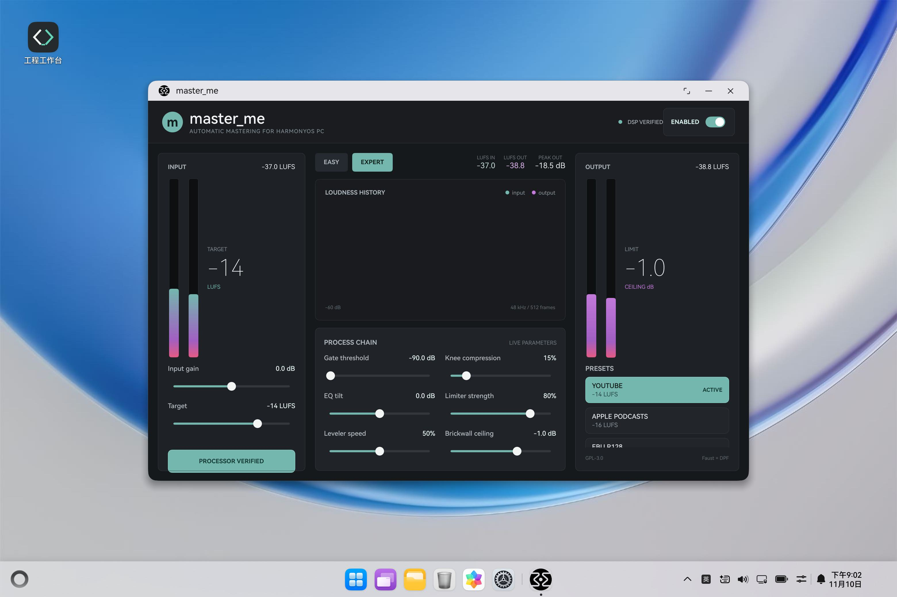

# master_me for HarmonyOS PC

This repository is the HarmonyOS PC adaptation of
[trummerschlunk/master_me](https://github.com/trummerschlunk/master_me).



The first milestone keeps the original Faust DSP as the audio source of truth and
replaces the desktop DPF/Pugl window with a HarmonyOS Stage application and ArkUI
front end. The native module builds the generated DPF/Faust processor into
`libmasterme.so` and exposes block processing, parameter control and presets to
ArkTS.

## Current scope

- HarmonyOS 2-in-1 Stage application under `harmony/`.
- Native NAPI bridge for the original stereo mastering processor.
- Easy/Expert control surface with the five upstream easy presets.
- Interleaved float32 stereo block API ready for HarmonyOS audio I/O.
- ARM64 and x86_64 native build targets for HarmonyOS PC and emulators.
- Upstream DSP, DPF and presets remain unchanged under `plugin/`, `pregen/` and
  `dpf/`.

## Requirements

- DevEco Studio with HarmonyOS SDK 26.0.0 or newer.
- The BiSheng native compiler and the `2in1` emulator or device toolchain.
- `ohpm` and `hvigorw` available from the DevEco Studio command-line environment.

## Open in DevEco Studio

1. Open `harmony/` as the project root.
2. Select the HarmonyOS PC or 2-in-1 target.
3. Build the `entry` module.

From a terminal with DevEco Studio installed:

```powershell
cd harmony
ohpm install
$env:REFRESH_CPP_MODULE = 'true'
hvigorw assembleHap --mode module -p product=default -p module=entry@default --no-daemon
```

The unsigned HAP is written to
`harmony/entry/build/default/outputs/default/entry-default-unsigned.hap`.
Configure a signing profile in DevEco Studio before installing it on a physical
device.

## Native API

The `libmasterme.so` module exposes:

- `createEngine(sampleRate, bufferSize)`
- `destroyEngine(handle)`
- `loadPreset(handle, presetIndex)`
- `setParameter(handle, parameterIndex, value)`
- `getParameter(handle, parameterIndex)`
- `processInterleaved(handle, input, output, frameCount)`
- `getMeterSnapshot(handle)`

`input` and `output` are `Float32Array` objects containing interleaved stereo
samples. The process API returns the current input/output LUFS-S and peak values.

## Next port milestone

The native and ArkUI surfaces are connected. The remaining device integration is
the OHAudio full-duplex transport: AudioCapturer -> NAPI process -> AudioRenderer,
plus device hot-plug and stream recovery. Keeping that work behind the block API
allows the DSP and UI to be tested independently of the audio device.

## Upstream

- Project: `trummerschlunk/master_me`
- Upstream revision imported for this port: `ea93d78a2b0406805c4993ba95badc0acee0a92c`
- DPF and DPF-Widgets are vendored at the revisions pinned by the upstream
  project, so no recursive submodule checkout is required.
- License: GPL-3.0-or-later, see `LICENSE`.
