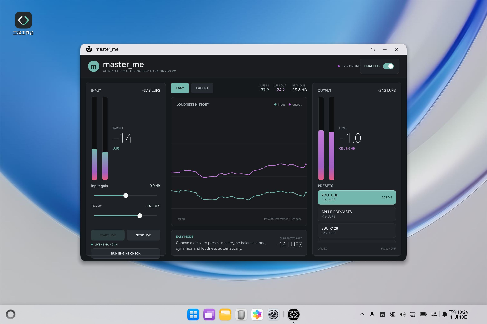

# master_me 的 OpenHarmony PC 适配记录

本文记录 `master_me` 迁移到 OpenHarmony PC 的工程结构、技术路线、编译运行方法和
T0/T1/T2 能力完成情况。

- OpenHarmony PC 适配仓库：<https://gitcode.com/OpenHarmonyPCDeveloper/ohos_master_me>
- 上游项目：<https://github.com/trummerschlunk/master_me>
- 上游导入版本：`ea93d78a2b0406805c4993ba95badc0acee0a92c`
- 开源许可证：GPL-3.0-or-later

## 迁移目标与技术路线

`master_me` 是面向直播和网络电台的自动母带处理工具。上游工程由 Faust DSP、
DPF 插件框架和 Pugl 桌面界面组成，主要运行形态是 CLAP、VST、VST3、AU、LV2
插件及 Jack 独立程序。

本次适配保留了原始 Faust DSP 和参数模型，没有重写音频算法。桌面端 DPF/Pugl
窗口替换为 HarmonyOS Stage 应用和 ArkUI 界面，原生 DSP 则由 NAPI 暴露给
ArkTS。设备音频通过 OHAudio 接入：采集回调写入环形缓冲，渲染回调取出输入、
执行 DSP 并输出监听音频。这样做可以继续复用上游 DSP、预设和参数定义，同时
按 HarmonyOS PC 的应用模型重建窗口、生命周期和音频设备接入层。

迁移能力包括：

- 将上游 Faust/DPF C++ 处理器编译为 HarmonyOS 原生动态库。
- 通过 NAPI 完成 ArkTS 与 C++ DSP 之间的生命周期、参数、预设和音频块传递。
- 使用 ArkUI 重建 Easy/Expert 操作界面，适配 `2in1` 设备类型。
- 复用上游五种 Easy 预设和原有参数语义，保留参数双向读取。
- 同时构建 `arm64-v8a` 与 `x86_64`，覆盖 HarmonyOS PC 设备和模拟器。
- 接入 OHAudio 48 kHz 双声道全双工链路，提供启动、停止、状态和实时电平。
- 处理麦克风权限、设备变化、音频中断、错误和音频流重建。
- 保留上游代码边界，为后续上游同步保留稳定的 NAPI 接口。

## 工程结构

```text
.
├── harmony/                         # HarmonyOS Stage 应用
│   ├── AppScope/                    # 应用级配置和 Bundle ID
│   └── entry/
│       └── src/main/
│           ├── ets/
│           │   ├── engine/          # ArkTS NAPI 封装
│           │   ├── entryability/    # 应用生命周期入口
│           │   └── pages/           # Easy/Expert ArkUI 主界面
│           └── cpp/
│               ├── CMakeLists.txt   # 原生模块构建配置
│               └── master_me_engine.cpp
├── plugin/                          # 上游 master_me 处理器
├── pregen/                          # Faust 生成的 DSP C++
├── dpf/                             # 上游 DPF 运行时
├── HARMONYOS.md                     # 英文适配与 API 说明
└── README.OpenHarmony_CN.md         # 本文
```

HarmonyOS 入口模块名为 `entry`，设备类型为 `2in1` 和 `tablet`，
Bundle ID 为 `de.fourthohm.masterme`，当前应用版本为 `1.3.2-ohos.1`。

## 环境要求

| 项目 | 要求 |
| --- | --- |
| DevEco Studio | 支持 HarmonyOS API 26 |
| HarmonyOS SDK | `26.0.0` 或更高 |
| 原生编译器 | BiSheng |
| 目标平台 | HarmonyOS PC / `2in1`，支持 ARM64 与 x86_64 |
| 构建工具 | `ohpm`、`hvigorw` |
| 签名 | 真机安装前需在 DevEco Studio 配置签名 Profile |

建议从 DevEco Studio 命令行环境启动终端，确保 `DEVECO_SDK_HOME`、`hvigorw`
和 `ohpm` 均可直接调用。

## 编译与运行

### 1. 获取源码

```powershell
git clone https://gitcode.com/OpenHarmonyPCDeveloper/ohos_master_me.git
cd ohos_master_me
```

### 2. 安装 HarmonyOS 工程依赖

```powershell
cd harmony
ohpm install
```

### 3. 构建 HAP

修改原生模块后需要刷新 CMake 配置：

```powershell
$env:REFRESH_CPP_MODULE = 'true'
hvigorw assembleHap --mode module -p product=default -p module=entry@default --no-daemon
```

未签名产物位于：

```text
harmony/entry/build/default/outputs/default/entry-default-unsigned.hap
```

### 4. 在 DevEco Studio 中运行

1. 使用 DevEco Studio 打开 `harmony/` 目录。
2. 等待工程同步完成，并在 `Project Structure > Signing Configs` 配置签名。
3. 选择 HarmonyOS PC 真机或 `2in1` 模拟器。
4. 运行 `entry` 模块。

### 5. 使用 hdc 安装和启动

签名后可通过命令行安装并启动：

```powershell
hdc install -r harmony/entry/build/default/outputs/default/entry-default-signed.hap
hdc shell aa start -a EntryAbility -b de.fourthohm.masterme -m entry
```

应用启动后：

1. 点击 `START LIVE`。
2. 首次使用时允许 `ohos.permission.MICROPHONE` 麦克风权限。
3. 状态显示 `LIVE 48 kHz / 2 CH` 后，输入、输出电平和历史曲线会持续更新。
4. 点击 `STOP LIVE` 可释放采集与渲染流。
5. 点击 `RUN ENGINE CHECK` 会处理 440 Hz 双声道测试块，成功后显示
   `DSP VERIFIED`。



## PC 适配实现

### 原生 DSP

`harmony/entry/src/main/cpp/master_me_engine.cpp` 直接包含上游
`plugin/MasterMePlugin.cpp`，将原始 Faust/DPF 处理器编译进
`libmasterme.so`。原生层负责：

- 创建和销毁 DSP 实例。
- 加载上游 Easy 预设并同步参数。
- 读写指定参数。
- 接收交错双声道 `Float32Array`，完成块处理。
- 返回输入/输出 LUFS 和峰值。
- 创建 `AudioCapturer` 和 `AudioRenderer`，使用 `S16LE / 48 kHz / 2 ch`。
- 在采集与渲染回调之间维护有界环形缓冲，由渲染回调驱动 DSP。
- 暴露回调帧数、欠载、溢出、设备变化、恢复次数和最后错误。

对 DSP 的访问通过互斥锁串行化，音频缓冲区按实际帧数扩展。设备变化、中断和
错误会标记恢复状态，状态轮询按 2 秒节流重建音频流，避免事件回调直接阻塞
UI 线程。

### ArkTS 与 NAPI

`MasterMeEngine.ets` 封装以下原生接口：

```text
createEngine(sampleRate, bufferSize)
destroyEngine(handle)
loadPreset(handle, presetIndex)
setParameter(handle, parameterIndex, value)
getParameter(handle, parameterIndex)
processInterleaved(handle, input, output, frameCount)
getMeterSnapshot(handle)
startAudio(handle)
stopAudio(handle)
getAudioStatus(handle)
```

`input` 和 `output` 为交错双声道 `Float32Array`。`startAudio` 返回当前音频
状态并启动全双工链路；`getAudioStatus` 用于轮询运行状态和回调统计。

### ArkUI 界面

HarmonyOS 界面保留上游 Easy/Expert 两种工作方式：

- Easy 模式提供 YOUTUBE、APPLE PODCASTS、EBU R128、SPEECH、MUSIC 五种预设。
- Expert 模式提供 Gate、EQ、Leveler、Compression、Limiter 和 Ceiling 参数。
- 主界面提供输入增益、目标 LUFS、旁路开关、电平历史和引擎自检入口。
- 主界面提供 `START LIVE`、`STOP LIVE`、流状态、回调帧和欠载统计。
- 输入/输出 LUFS 历史曲线由 OHAudio 回调持续驱动。
- 麦克风权限只在用户启动实时监听时申请。

### 构建与生命周期

原生模块在 `CMakeLists.txt` 中链接 `libace_napi.z.so` 与
`libohaudio.so`，并构建 `arm64-v8a`、`x86_64` 两种 ABI。Stage 应用在
`aboutToAppear` 创建引擎并启动状态轮询，在 `aboutToDisappear` 停止音频流、
清除定时器并释放原生引擎。

## 迁移能力分级

本文按以下口径划分阶段：

- **T0 基础能力**：能否构建、安装、启动，原生模块和应用界面是否能正常加载。
- **T1 主要能力**：无需真实音频设备即可验证的核心业务能力，包括 DSP、预设、
  参数、自检和块处理。
- **T2 完整能力**：接入 HarmonyOS 音频设备后，能够完成真实输入到输出闭环，
  并处理设备变化和发布部署。

### T0 基础能力

| 能力 | 状态 | 说明 |
| --- | --- | --- |
| HAP 构建 | 已验证 | `hvigorw assembleHap` 构建成功 |
| 安装 / 启动 | 已验证 | HarmonyOS API 26 `2in1` 模拟器安装并启动成功 |
| ArkUI 主界面 | 已验证 | Easy/Expert 界面可正常渲染，无白屏 |
| 原生模块加载 | 已验证 | `libmasterme.so` 可被 ArkTS 加载 |
| 应用退出清理 | 已完成 | 页面销毁时调用原生引擎销毁接口 |
| 真机签名安装 | 待配置 | 需使用开发者签名 Profile 生成签名 HAP |

T0 的构建、启动和原生模块加载链路已经打通。当前仓库中的本地 HAP 为未签名
产物，因此物理 HarmonyOS PC 的签名安装不作为已验证项。

### T1 主要能力

| 能力 | 状态 | 说明 |
| --- | --- | --- |
| 原始 Faust/DPF DSP | 已验证 | 440 Hz 双声道测试块产生非静音输出 |
| 引擎自检 | 已验证 | 自检完成后显示 `DSP VERIFIED` |
| Easy 预设 | 已完成 | 五种上游预设可加载并同步参数 |
| Expert 参数控制 | 已验证 | Gate、EQ、Leveler、Compression、Limiter、Ceiling 可调 |
| 参数读写 | 已完成 | ArkTS 可通过 NAPI 读写原生参数 |
| 旁路控制 | 已完成 | UI 开关映射到上游 Bypass 参数 |
| 双声道块处理 | 已完成 | 交错 `Float32Array` 输入/输出 |
| LUFS / 峰值快照 | 已完成 | 原生返回输入、输出 LUFS 与峰值 |
| Easy/Expert 模式切换 | 已验证 | Expert 模式在模拟器完整显示且无裁切 |
| 实时电平历史 | 已验证 | OHAudio 回调驱动输入/输出曲线 |

T1 已形成可运行的 DSP/UI 基线，能够通过确定性测试信号验证原生处理链。

### T2 完整能力

| 能力 | 状态 | 说明 |
| --- | --- | --- |
| OHAudio 全双工音频 | 模拟器已验证 | `AudioCapturer -> DSP -> AudioRenderer` 持续运行 |
| 默认输入/输出设备 | 模拟器已验证 | 使用系统默认虚拟麦克风和扬声器路由 |
| 实时监听 | 模拟器已验证 | 渲染回调持续输出，界面更新输入/输出电平 |
| 实时电平曲线 | 已验证 | 输入/输出曲线由原生回调数据驱动 |
| 设备热插拔 | 已实现，待真机验证 | 监听设备变化并触发有节流的流恢复 |
| 音频流恢复 | 已实现，待故障注入 | 处理暂停、停止、错误和服务状态变化 |
| 低延迟配置 | 模拟器已验证 | `AUDIOSTREAM_LATENCY_MODE_FAST`，回调帧长自适应 |
| 麦克风权限 | 已验证 | 首次启动实时监听时弹出权限窗口 |
| 启动 / 停止 | 已验证 | `START LIVE` 与 `STOP LIVE` 可重复释放和重建流 |
| 签名发布 HAP | 未完成 | 需配置正式签名并上传 `hap.atomgit.com` |

T2 的音频主链路已经在 HarmonyOS API 26 `2in1` 模拟器完成运行验收。剩余的
发布级工作集中在物理 HarmonyOS PC 的真实麦克风/扬声器、拔插故障注入和正式
签名安装；这些项目不能由当前模拟器环境替代验证。

## 本轮验收记录

验收日期：2026-11-10。环境为 HarmonyOS API 26 `2in1` 模拟器，目标
`x86_64`，设备地址 `127.0.0.1:5555`。

| 验收项 | 结果 |
| --- | --- |
| `hvigorw assembleHap` | 通过，`arm64-v8a` 与 `x86_64` 均构建成功 |
| `hdc install -r` | 未签名 HAP 安装成功 |
| `aa start` | `EntryAbility` 启动成功，无白屏或崩溃 |
| 麦克风权限 | 首次点击 `START LIVE` 正常弹出授权窗口 |
| OHAudio 启动 | 状态显示 `LIVE 48 kHz / 2 CH` |
| 持续音频回调 | 20 秒内累计帧数由 557,280 增长到 1,367,040，渲染持续运行 |
| 运行期稳定性 | 启动阶段后 gaps 保持 128，连续 20 秒未增长 |
| 实时电平图 | 输入/输出 LUFS 与双色历史曲线持续更新 |
| `STOP LIVE` | 状态恢复为 `LIVE AUDIO OFF` |
| 引擎自检 | `RUN ENGINE CHECK` 后显示 `DSP VERIFIED` |

模拟器虚拟采集源在启动/停止过渡阶段可能出现系统级
`HandleCapturerRead` 超时日志，当前实现通过输入环形缓冲和渲染线程驱动 DSP
保持输出连续。该现象没有在运行期继续恶化，但物理麦克风的采样质量、实际听感、
设备拔插和音频焦点恢复仍需在 HarmonyOS PC 真机复核。

## 当前阶段判定

当前版本已满足 T0、T1，并在 API 26 `2in1` 模拟器上完成 T2 的 OHAudio
全双工、实时监听、状态统计、启动停止、权限和实时电平曲线验收。由于尚未在
物理 HarmonyOS PC 上验证真实设备拔插、音频焦点恢复和签名安装，仓库状态应
描述为“T2 模拟器验收通过，真机发布验收待完成”。

## 上游同步

- 上游 DSP、预设和参数定义仍以 `plugin/`、`pregen/` 为准。
- DPF、DPF-Widgets 和 Pugl 已按上游固定版本内置，不依赖子模块递归拉取。
- 修改 DSP 或参数定义后，需要重新执行 HAP 构建以刷新原生模块。
- HarmonyOS 专用的 NAPI 桥和 ArkUI 代码集中在 `harmony/`，便于与上游比较。

更简短的英文构建与原生 API 说明见 [HARMONYOS.md](HARMONYOS.md)。
